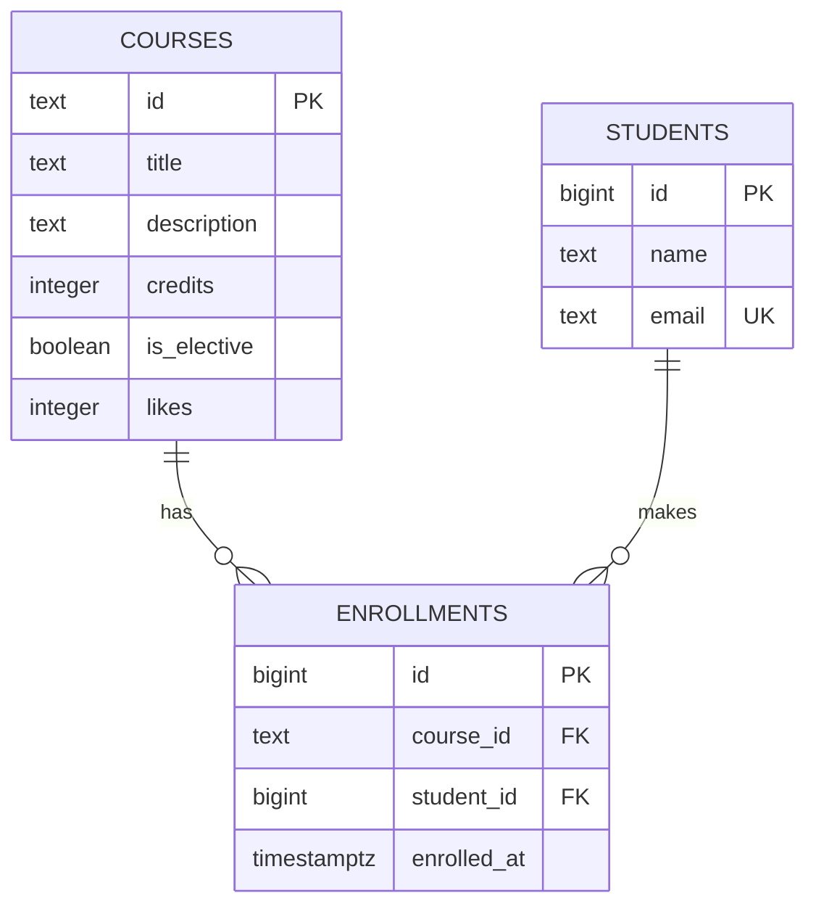

# Course Catalog Database — Lab 6

PostgreSQL schema for a small course catalog. The project demonstrates relational
modeling, integrity constraints, joins, transactions, and index analysis without
changing the existing frontend or API repositories.

## Repository structure

```text
course-catalog-db/
├── schema.sql
├── seed.sql
├── queries.sql
├── README.md
└── experiments/
    ├── idx_data.sql
    ├── norm_demo.sql
    ├── norm_to_schema.sql
    ├── lost_update.sql
    ├── sql_injection.sql
    └── email_constraint.sql
```

## Requirements

- PostgreSQL 16 or newer
- `psql` command-line client

## Database setup

Run the administrative commands as a PostgreSQL superuser:

```sql
CREATE ROLE catalog_app WITH LOGIN PASSWORD 'change-me';
CREATE DATABASE course_catalog OWNER catalog_app;
```

Set the password for the current terminal, then create and populate the schema:

```bash
export PGPASSWORD='change-me'
psql -v ON_ERROR_STOP=1 -U catalog_app -d course_catalog -f schema.sql
psql -v ON_ERROR_STOP=1 -U catalog_app -d course_catalog -f seed.sql
psql -v ON_ERROR_STOP=1 -U catalog_app -d course_catalog -f queries.sql
```

PowerShell equivalent:

```powershell
$env:PGPASSWORD = 'change-me'
psql -v ON_ERROR_STOP=1 -U catalog_app -d course_catalog -f schema.sql
psql -v ON_ERROR_STOP=1 -U catalog_app -d course_catalog -f seed.sql
psql -v ON_ERROR_STOP=1 -U catalog_app -d course_catalog -f queries.sql
```

`schema.sql` drops the three lab tables before recreating them, so the setup can
be repeated. `queries.sql` rolls back its example writes and is also repeatable.

Verify the seeded row counts:

```sql
SELECT 'courses' AS table_name, count(*) FROM courses
UNION ALL
SELECT 'students', count(*) FROM students
UNION ALL
SELECT 'enrollments', count(*) FROM enrollments;
```

Expected counts are 6 courses, 3 students, and 6 enrollments.

## Entity-relationship diagram



`enrollments` is the junction table that implements the many-to-many relationship
between students and courses. Its unique constraint on `(course_id, student_id)`
prevents the same student from enrolling in the same course twice.

## Design decisions

### Course and student identifiers

Course IDs are `text` slugs such as `modern-frontend`. They are stable,
human-readable, and suitable for URLs. Student IDs are generated `bigint` values
because students do not have a natural public identifier and automatic numeric
keys make inserts and joins straightforward.

### Referential actions

- `enrollments.course_id` uses `ON DELETE RESTRICT`. A course with enrollment
  history cannot be deleted accidentally; the application must handle that case.
- `enrollments.student_id` uses `ON DELETE CASCADE`. Removing a student also
  removes rows that only describe that student's enrollments.

The course itself is never deleted by either action.

### Data types

- `timestamptz` stores one absolute moment and renders it in the session time
  zone. Plain `timestamp` has no time-zone context and is easier to misinterpret.
- PostgreSQL `text` and `varchar(n)` have the same general storage and performance
  characteristics. `text` is used where the domain has no genuine business
  maximum; explicit `CHECK` constraints express the limits that matter.
- `integer` is appropriate for credits and likes, while `bigint` identity keys
  leave ample space for generated identifiers.

## Query catalogue

`queries.sql` contains examples for:

1. filtering, sorting, and paginating courses;
2. retrieving a course by ID, including the not-found case;
3. incrementing likes;
4. creating an enrollment;
5. listing enrollments with student and course names;
6. counting enrollments for every course;
7. finding courses with no enrollments;
8. finding students enrolled in more than one course.

The statistics query uses `count(e.id)`, not `count(*)`, so a course with no
matching enrollment receives a count of zero after the `LEFT JOIN`.

## Constraint violation log

The following cases demonstrate that correctness does not depend only on the
application. PostgreSQL rejects invalid writes even when SQL is executed directly.
All listed SQLSTATE and constraint names were verified on PostgreSQL 16.14.

| Test case | SQLSTATE | Constraint or column | Suggested API status |
|---|---:|---|---:|
| Course title is `NULL` | `23502` | `courses.title` (`NOT NULL`) | `422` |
| Course credits are `0` | `23514` | `courses_credits_check` | `422` |
| Course likes are `-1` | `23514` | `courses_likes_check` | `500` |
| Student name has one character | `23514` | `students_name_check` | `422` |
| Student email already exists | `23505` | `students_email_key` | `409` |
| Course ID already exists | `23505` | `courses_pkey` | `409` |
| Enrollment pair already exists | `23505` | `enrollments_course_id_student_id_key` | `409` |
| Course ID does not exist | `23503` | `enrollments_course_id_fkey` | `404` |
| Student ID does not exist | `23503` | `enrollments_student_id_fkey` | `404` |
| Delete a course that still has enrollments | `23503` on PostgreSQL 16/17 (`23001` may be used in PostgreSQL 18) | `enrollments_course_id_fkey` | `409` |

Deleting seeded student Daniyar Bekov demonstrates `ON DELETE CASCADE`:

```sql
BEGIN;
SELECT count(*) FROM enrollments; -- 6
DELETE FROM students WHERE email = 'daniyar@example.com';
SELECT count(*) FROM enrollments; -- 3
ROLLBACK;
SELECT count(*) FROM enrollments; -- 6 again
```

### Why validation is duplicated in Pydantic and PostgreSQL

Pydantic gives API clients fast, readable `422 Unprocessable Entity` responses
before a query is sent. Database constraints remain essential because data can
also be written by scripts, migrations, administrative tools, other services, or
concurrent requests. Pydantic improves the interface; PostgreSQL is the final
authority for stored data. A backend should translate known SQLSTATE values such
as unique (`23505`), foreign-key (`23503`), and check (`23514`) violations into
stable HTTP responses instead of returning an unexplained server error.

## Index experiment

`experiments/idx_data.sql` adds 500 courses, 20,000 students, and 50,000
enrollments. Use a separate database so the lab seed counts remain unchanged:

```sql
CREATE DATABASE course_catalog_idx OWNER catalog_app;
```

```bash
psql -v ON_ERROR_STOP=1 -U catalog_app -d course_catalog_idx -f schema.sql
psql -v ON_ERROR_STOP=1 -U catalog_app -d course_catalog_idx -f experiments/idx_data.sql
```

For the before measurement, remove the explicit foreign-key index and execute the
same query several times:

```sql
DROP INDEX enrollments_student_id_idx;
ANALYZE enrollments;
EXPLAIN (ANALYZE, BUFFERS)
SELECT * FROM enrollments WHERE student_id = 777;
```

The measured plan without the index scanned the complete table:

```text
Seq Scan on enrollments  (cost=0.00..1042.00 rows=3 width=34)
  (actual time=0.048..2.312 rows=3 loops=1)
  Filter: (student_id = 777)
  Rows Removed by Filter: 49997
  Buffers: shared hit=417
Execution Time: 2.361 ms
```

Create the index and repeat the exact query:

```sql
CREATE INDEX enrollments_student_id_idx ON enrollments (student_id);
ANALYZE enrollments;
EXPLAIN (ANALYZE, BUFFERS)
SELECT * FROM enrollments WHERE student_id = 777;
```

After creating the index, the second (cache-warm) measured plan was:

```text
Bitmap Heap Scan on enrollments  (cost=4.31..15.59 rows=3 width=34)
  (actual time=0.031..0.043 rows=3 loops=1)
  Recheck Cond: (student_id = 777)
  Heap Blocks: exact=3
  -> Bitmap Index Scan on enrollments_student_id_idx
       (actual time=0.024..0.024 rows=3 loops=1)
       Index Cond: (student_id = 777)
Execution Time: 0.101 ms
```

These measurements were taken on PostgreSQL 16.14 in the lab Docker container.
The first cold indexed execution took `1.324 ms`; the repeated warm execution took
`0.101 ms`. Exact timings depend on hardware, caching, and data distribution. The
important change is from examining 50,000 rows to locating three matching index
entries.

| Measurement | Plan | Rows inspected | Measured time |
|---|---|---:|---:|
| Before index, warm run | Sequential scan | 50,000 | 2.361 ms |
| After index, cold run | Bitmap index/heap scan | 3 matches | 1.324 ms |
| After index, warm run | Bitmap index/heap scan | 3 matches | 0.101 ms |

PostgreSQL automatically indexes primary keys and unique constraints, but it does
not automatically index the referencing side of a foreign key. Therefore:

- `students.email` uses the index created by `UNIQUE`;
- `enrollments.course_id` can use the unique `(course_id, student_id)` index
  because `course_id` is its first column;
- `enrollments.student_id` needs its own index because it is the second column of
  that composite index;
- a query on the six-row `courses` table may still choose a sequential scan even
  though a primary-key index exists, because reading the small table is cheaper.

The student index speeds up enrollment listings and helps PostgreSQL locate the
dependent rows that must be removed during a cascaded student deletion.

## Transaction experiment

### Failed transaction is atomic

```sql
BEGIN;

INSERT INTO students (name, email)
VALUES ('Transaction Student', 'transaction@example.com');

INSERT INTO enrollments (course_id, student_id)
VALUES ('course-does-not-exist',
        (SELECT id FROM students WHERE email = 'transaction@example.com'));

-- PostgreSQL now reports that the current transaction is aborted.
SELECT * FROM students WHERE email = 'transaction@example.com';

ROLLBACK;

-- Returns zero rows: the first successful insert was rolled back too.
SELECT * FROM students WHERE email = 'transaction@example.com';
```

The foreign-key failure aborts the transaction. Until `ROLLBACK`, PostgreSQL
refuses subsequent statements. No partial result survives. In the executed test,
the final query returned `0` rows for `transaction@example.com`; the database
still contained exactly 6 courses, 3 students, and 6 enrollments. Without the
transaction, the first insert would remain committed after the second insert
failed, leaving a student with no enrollment.

### Visibility between two connections

In connection A, start a transaction and insert a student plus an enrollment, but
do not commit yet. A query from connection B returns zero matching rows because
the default `READ COMMITTED` isolation level hides uncommitted changes. After
connection A runs `COMMIT`, connection B sees both rows. The student and their
enrollment become visible as one atomic change, never as a half-completed state.
The executed two-connection test returned `0 students / 0 enrollments` before
`COMMIT` and `1 student / 1 enrollment` after `COMMIT`. The test student was then
removed, returning the main database to the required 6/3/6 row counts.

## Bonus tasks

### Bonus 1: normalization anomalies

`experiments/norm_demo.sql` creates a deliberately flat `registrations` table
and demonstrates all three anomalies inside transactions that are rolled back:

- update anomaly: one course obtains two different titles;
- delete anomaly: deleting the only enrollment also loses the course facts;
- insert anomaly: storing a course with no enrollment requires a row with an
  empty student.

Run the flat-table experiment in a throwaway database, then migrate its data into
the normalized schema:

```bash
createdb -U catalog_app -O catalog_app norm_demo
psql -v ON_ERROR_STOP=1 -U catalog_app -d norm_demo -f experiments/norm_demo.sql
psql -v ON_ERROR_STOP=1 -U catalog_app -d norm_demo -f schema.sql
psql -v ON_ERROR_STOP=1 -U catalog_app -d norm_demo -f experiments/norm_to_schema.sql
```

The normalized result contains 3 students, 3 courses, and 6 enrollments. The
other three catalog courses could not be recovered because a flat registration
table has nowhere to store a course with no enrollment.

### Bonus 2: lost update and row lock

`experiments/lost_update.sql` compares two clients writing the same computed
value with two atomic increments. The first approach finishes at 12 instead of
13, so one like is lost. `SET likes = likes + 1` finishes at 13 because PostgreSQL
computes from the current row value while holding a row lock. The file ends with
`ROLLBACK` and leaves the seed unchanged.

To see the lock, set `api-design` back to 11. In console A, leave this transaction
open:

```sql
BEGIN;
UPDATE courses
SET likes = likes + 1
WHERE id = 'api-design'
RETURNING likes;
```

Run the same `UPDATE` in console B. It waits. Run `COMMIT` in A; B then completes
and returns 13. Reset the teaching data with:

```sql
UPDATE courses SET likes = 11 WHERE id = 'api-design';
```

### Bonus 3: parameters prevent SQL injection

`experiments/sql_injection.sql` first runs the vulnerable condition
`id = 'x' OR '1' = '1'`, which returns all six courses. It then passes the attack
text to a prepared statement as one `text` parameter and gets zero rows. A
parameter is parsed only as a value, not as executable SQL syntax.

### Bonus 4: two additional queries

Queries 7 and 8 in `queries.sql` are the two bonus queries. Query 7 uses
`LEFT JOIN` plus `WHERE e.id IS NULL` and returns the three courses with no
enrollments. Query 8 groups enrollments by student and uses
`HAVING count(*) > 1`; `HAVING` filters groups after aggregation, whereas `WHERE`
filters individual rows before aggregation.

### Bonus 5: adding a rule to a live table

`experiments/email_constraint.sql` removes and re-adds the explicitly named
`students_email_format` constraint with `ALTER TABLE`, without recreating the
table. PostgreSQL checks all existing rows before accepting a new constraint.
The same rule is also present in `schema.sql`, so a database created from scratch
has the final schema.

After running the experiment file, this insert must fail with
`students_email_format`:

```sql
INSERT INTO students (name, email)
VALUES ('Test User', 'no-at-sign');
```

## Self-review against the checklist

| What to check | Result |
|---|---|
| Keys | Yes — every table has a primary key; `enrollments` has both required foreign keys. |
| Types | Yes — slugs use `text`, generated IDs use `bigint`, and moments use `timestamptz`. |
| Required values | Yes — all domain-required columns are `NOT NULL`. |
| Constraints | Yes — domain rules use `CHECK` and `UNIQUE`, including the enrollment pair. |
| Deletion | Yes — course deletion is `RESTRICT`; student deletion is `CASCADE`. |
| Normalization | Yes — student and course facts are stored once; the junction table stores only relationships. |
| Indexes and names | Yes — names use snake_case and the uncovered `student_id` foreign key has an explicit index. |
