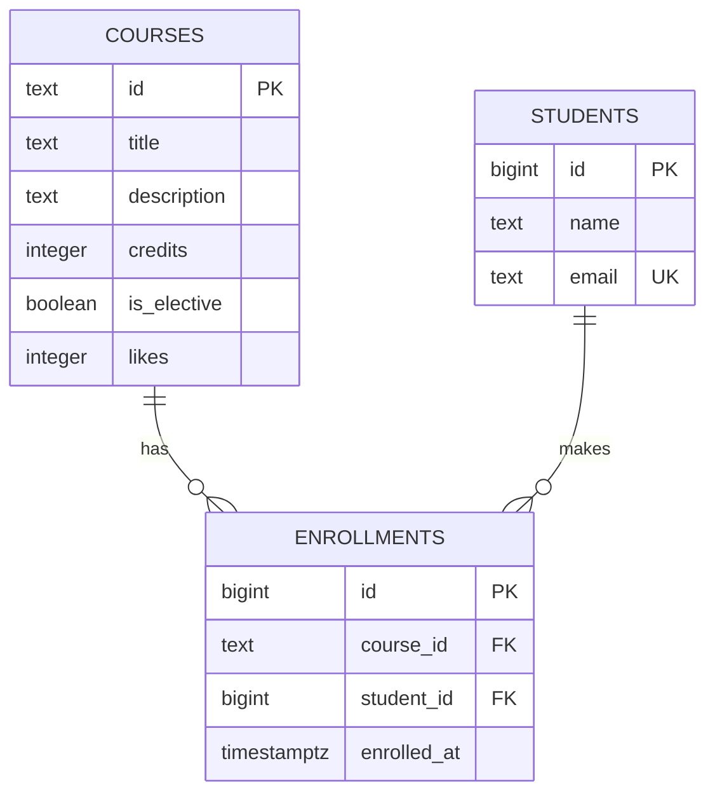

# Course Catalog Database — Lab 6

PostgreSQL schema for a small course catalog. The project demonstrates relational
modeling, integrity constraints, joins, transactions, and index analysis without
changing the existing frontend or API repositories.

## Repository structure

```text
course-catalog-db/
├── schema.sql
├── seed.sql
├── queries.sql
├── README.md
└── experiments/
    └── idx_data.sql
```

## Requirements

- PostgreSQL 16 or newer
- `psql` command-line client

## Database setup

Run the administrative commands as a PostgreSQL superuser:

```sql
CREATE ROLE catalog_app WITH LOGIN PASSWORD 'change-me';
CREATE DATABASE course_catalog OWNER catalog_app;
```

Set the password for the current terminal, then create and populate the schema:

```bash
export PGPASSWORD='change-me'
psql -v ON_ERROR_STOP=1 -U catalog_app -d course_catalog -f schema.sql
psql -v ON_ERROR_STOP=1 -U catalog_app -d course_catalog -f seed.sql
psql -v ON_ERROR_STOP=1 -U catalog_app -d course_catalog -f queries.sql
```

PowerShell equivalent:

```powershell
$env:PGPASSWORD = 'change-me'
psql -v ON_ERROR_STOP=1 -U catalog_app -d course_catalog -f schema.sql
psql -v ON_ERROR_STOP=1 -U catalog_app -d course_catalog -f seed.sql
psql -v ON_ERROR_STOP=1 -U catalog_app -d course_catalog -f queries.sql
```

`schema.sql` drops the three lab tables before recreating them, so the setup can
be repeated. `queries.sql` rolls back its example writes and is also repeatable.

Verify the seeded row counts:

```sql
SELECT 'courses' AS table_name, count(*) FROM courses
UNION ALL
SELECT 'students', count(*) FROM students
UNION ALL
SELECT 'enrollments', count(*) FROM enrollments;
```

Expected counts are 6 courses, 3 students, and 6 enrollments.

## Entity-relationship diagram



`enrollments` is the junction table that implements the many-to-many relationship
between students and courses. Its unique constraint on `(course_id, student_id)`
prevents the same student from enrolling in the same course twice.

## Design decisions

### Course and student identifiers

Course IDs are `text` slugs such as `modern-frontend`. They are stable,
human-readable, and suitable for URLs. Student IDs are generated `bigint` values
because students do not have a natural public identifier and automatic numeric
keys make inserts and joins straightforward.

### Referential actions

- `enrollments.course_id` uses `ON DELETE RESTRICT`. A course with enrollment
  history cannot be deleted accidentally; the application must handle that case.
- `enrollments.student_id` uses `ON DELETE CASCADE`. Removing a student also
  removes rows that only describe that student's enrollments.

The course itself is never deleted by either action.

### Data types

- `timestamptz` stores one absolute moment and renders it in the session time
  zone. Plain `timestamp` has no time-zone context and is easier to misinterpret.
- PostgreSQL `text` and `varchar(n)` have the same general storage and performance
  characteristics. `text` is used where the domain has no genuine business
  maximum; explicit `CHECK` constraints express the limits that matter.
- `integer` is appropriate for credits and likes, while `bigint` identity keys
  leave ample space for generated identifiers.

## Query catalogue

`queries.sql` contains examples for:

1. filtering, sorting, and paginating courses;
2. retrieving a course by ID, including the not-found case;
3. incrementing likes;
4. creating an enrollment;
5. listing enrollments with student and course names;
6. counting enrollments for every course;
7. finding courses with no enrollments;
8. finding students enrolled in more than one course.

The statistics query uses `count(e.id)`, not `count(*)`, so a course with no
matching enrollment receives a count of zero after the `LEFT JOIN`.
